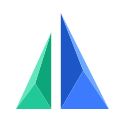
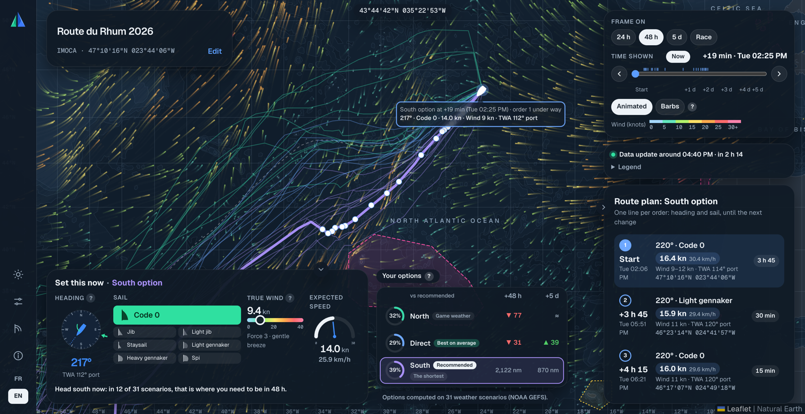
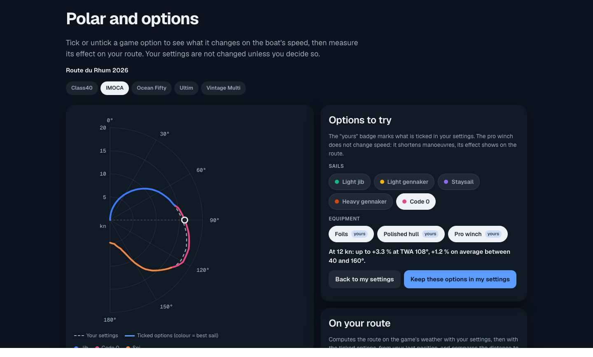

<div align="center">



# Regatta Copilot

**Weather routing advice for Virtual Regatta Offshore, built on 31 weather scenarios instead of one.**

[](LICENSE)


[Getting started](#getting-started) · [How it works](#how-it-works) · [Using it in the game](#using-it-in-the-game) · [FAQ](#faq) · [Technical docs](docs/ai/index.md)



</div>

You paste your boat's position, Regatta Copilot computes the best route on the game's own weather **and on 31 variants of it**, then tells you where the fleet of possible futures is heading: up to 3 route options, how likely each one is, how they compare, and the exact orders to type into the game (heading and sail, order by order).

A single "optimal" route changes every 6 hours with the forecast. Regatta Copilot shows you which choices hold up when the forecast is uncertain, and which ones are a bet.

## Features

- **The game's weather, read like the game**: NOAA GFS 0.25°, every 3 hours, interpolated in between, picked up 3 h 40 after each run as the game does.
- **31 scenarios**: the NOAA GEFS ensemble, routed one by one with your boat's polar, then grouped into at most 3 options with their probability ("14 of 31 scenarios").
- **Options compared fairly**: each option's route is sailed again in all 31 weathers and compared on distance to go to the finish through every mark, so a fast detour only counts if it gains ground. A **Best on average** badge flags the option that wins more often than the recommended one.
- **A route plan you can type**: one line per order, a constant heading the game can hold, never within 1 nm of a coast or an exclusion zone.
- **Your boat, not a generic one**: tick the sails and options you own (foils, polished hull, pro winch), set your manoeuvre times, import your own polar from the game.
- **Polar and options page**: see what a sail or an option changes on your polar, and how many miles it is worth on the current weather.
- **A real chart**: wind particles or barbs, a time bar over 5 days, numbered orders that pulse as you scrub through time, light and dark themes, French and English.

## Getting started

### 1. Requirements

- **Python 3.12+** on macOS or Linux (tested on macOS).
- **An internet connection** for the NOAA weather downloads: about 15 to 30 MB per game forecast and 100 MB per set of 31 scenarios, every 6 hours. Old forecasts are deleted automatically: about 230 MB of disk at most.
- A multi-core machine helps: the 31 scenarios are routed in parallel (about 40 s on a 10-core laptop).

### 2. Run it

```bash
git clone https://github.com/FabienPENCHENAT/regatta-copilot.git
cd regatta-copilot
./run.sh
```

The first run creates a Python environment and installs the dependencies. Then open **http://localhost:8000**. The script also prints an address to open on your phone, on the same Wi-Fi. 🎉

> [!NOTE]
> On the very first start, the site downloads the game's forecast (about 2 minutes) and shows the game's route alone. The 31 scenarios download in the background (about 15 minutes); the options appear as soon as they are ready, without reloading.

### 3. Set up your boat

Open the **settings** (sliders icon on the left) and tick what you own in the game: sails one by one, foils, polished hull, pro winch. Manoeuvre times are pre-filled with the game's values and can be edited. Everything is off by default, like a bare boat in the game.

Wondering whether an option is worth buying? The **Polar and options** page (sail icon on the left) draws your polar with and without it, and measures how many miles it is worth on your route with the current weather.

<div align="center">

</div>

## How it works

1. **Weather**: the game's forecast (NOAA GFS) and its 31 scenarios (NOAA GEFS) are downloaded and refreshed in the background every 10 minutes. Nothing is invented: the scenarios are computed by NOAA, Regatta Copilot only reads them.
2. **Routing**: for each scenario, an isochrone router tries a heading every 1° over 220° around the next mark, every 15 minutes at first, with your polar and options, and drops any track within 1 nm of land or an exclusion zone.
3. **Options**: routes passing the same place at +24 h and +48 h are grouped (at most 3 options). The probability of an option is its share of scenarios.
4. **Comparison**: each option's route is sailed again in all 31 weathers and compared on distance to go through every mark (the tour of an island included).
5. **Route plan**: the recommended route is cut into orders, each a straight line at a constant heading that stays close to the route and clear of hazards.

What you see on each option card:

| On the card | Meaning |
|---|---|
| **45 %** ring | Share of the 31 scenarios whose best route goes this way |
| **Recommended** | The most frequent option: the safe choice |
| **Game weather** | The route computed on the game's exact forecast falls in this option |
| **Best on average** | At least 10 nm ahead of the recommended one on average at +5 days, in all 31 weathers: a bet |
| *"32 nm behind at +48 h, level at +5 d"* | Mean lead or lag on the recommended option; under 10 nm reads "level" |

The full explanation, with diagrams, is on the site's **How it works** page.

## Using it in the game

1. Copy your position from the game and type it in the race card (degrees, minutes, seconds), then **Compute my route**.
2. Read **Set this now**: heading, sail, wind and speed for the selected option.
3. Type the orders of the **route plan** into the game, one per line. Scrub the time bar to see where each order takes you.
4. Recompute after each new forecast: the legend shows when the next one is due.

> [!IMPORTANT]
> **Regatta Copilot only advises.** It never connects to Virtual Regatta, never asks for your game login, never clicks or sends an order. You stay the skipper.

## Privacy

- **Runs on your computer.** No account, no tracking, no analytics.
- **Network use**: the server downloads public NOAA weather files; the pages load Leaflet and leaflet-velocity from public CDNs (cdnjs, jsDelivr) and the Geist font from Google Fonts. Your position, boat and settings are never sent anywhere.
- **Your imported polar stays local**, in `var/polars/`, which is git-ignored.

## Known limitations

- **One race for now**: Route du Rhum 2026. The course is checked against the game's chart; other races need a race file (see [Adding a race](#adding-a-race)).
- **Community polars**: the bundled polars are third-party copies of the game's data, not verified in the game. Import your own for exact speeds.
- **Not modelled**: skipper energy (the game makes tired skippers manoeuvre up to twice as slowly), the game's exact coastline (hence the 1 nm margin) and the auto-sail "boost".
- **No finish time**: beyond 2 to 3 days the weather is too uncertain; the tool does not pretend otherwise.
- **The scenarios are a little overconfident**, like most ensemble forecasts: 55 % is really less clear-cut.

## FAQ

<details>
<summary><b>Why not just follow the route on the game's weather?</b></summary>

Because that weather changes every 6 hours. The game's route is shown (the faint dashed line and the "Game weather" badge), but the 31 scenarios tell you whether it is a solid choice or a lucky one.
</details>

<details>
<summary><b>The 10/31 option's line goes further than the recommended one. Is it better?</b></summary>

Not necessarily: each option's line is drawn in its own scenario's weather, so lengths compare weathers, not choices. Look at the comparison line on the card ("ahead / behind / level"), which sails every option in the same 31 weathers.
</details>

<details>
<summary><b>How do I import my own polar from the game?</b></summary>

Open the game in a desktop browser, open the developer tools' Network tab, find the `Meta_GetPolar` response and copy it. Paste it in **Settings → Polar**. Only the polar itself is stored. A step-by-step guide (in French) is in [docs/founder/extraire-polaire-vr.md](docs/founder/extraire-polaire-vr.md).
</details>

<details>
<summary><b>Can I use it on my phone?</b></summary>

Yes, on the same Wi-Fi as the computer running it: `run.sh` prints the address to open. The layout adapts to small screens.
</details>

<details>
<summary><b>The wind animation is too busy.</b></summary>

Switch to **Barbs** in the map controls: no animation. The site also follows your system's "reduce motion" setting.
</details>

## Adding a race

A race is a JSON file in [`races/`](races/): start lines per boat class, marks in order (gates, lines, marks to leave to port or starboard), the finish line and the exclusion zones, plus the boats' polars in [`data/polars/`](data/polars/). The format and the rules behind it are described in the [technical docs](docs/ai/index.md).

## Contributing

Bug reports and ideas are welcome in the [issues](../../issues).

```bash
./run.sh                                  # creates .venv on first run
.venv/bin/python -m pytest backend        # runs the test suite
```

The backend is Python (FastAPI, numpy, eccodes, shapely), the frontend plain JavaScript modules with Leaflet, no build step. Every UI text lives in `frontend/i18n/fr.json` and `en.json`. The [technical docs](docs/ai/index.md) describe the architecture, the conventions and every design decision.

## Credits and license

- Weather: [NOAA NOMADS](https://nomads.ncep.noaa.gov/) GFS and GEFS (public domain).
- Coastline and depths: [Natural Earth](https://www.naturalearthdata.com/) (public domain).
- Map: [Leaflet](https://leafletjs.com/) and [leaflet-velocity](https://github.com/onaci/leaflet-velocity).
- Community polars: [vro.civis.net](https://vro.civis.net/), see [data/polars/SOURCES.md](data/polars/SOURCES.md).

Regatta Copilot is an independent fan project. It is not affiliated with or endorsed by Virtual Regatta. "Virtual Regatta" is a trademark of its owner.

Released under the [MIT License](LICENSE).
